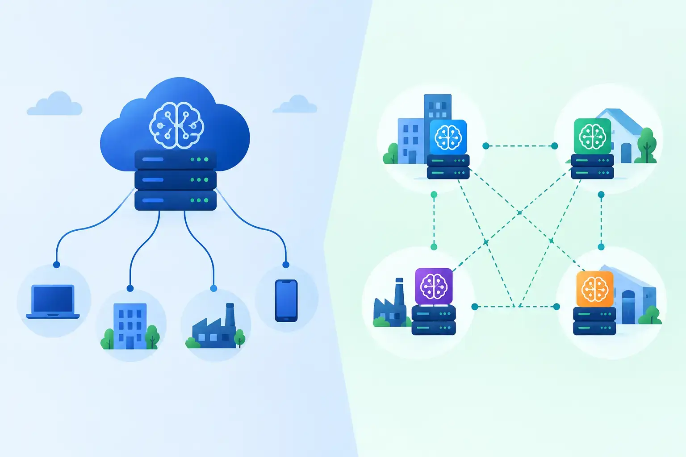

A central AI team can approve every use case and still fail to create value. A federated model can put capability close to the business and still create unmanaged risk. AI centralisation versus federation is therefore not a technology choice. It is an operating\-model decision about where authority sits, how knowledge moves, and who is accountable when an AI\-enabled product affects customers, employees, regulators or profit.

For established organisations, the wrong answer is rarely obvious on day one. It becomes visible later, through duplicated tooling, inconsistent controls, stalled delivery, unsupported models and business teams that work around central processes. AI does not wait for a perfect governance chart. Leaders need an operating model that allows useful work to proceed while keeping risk, cost and institutional knowledge under control.

## The real question behind AI centralisation versus federation

Centralisation and federation are often presented as opposites. In practice, neither extreme serves a complex enterprise well.

A fully centralised AI function concentrates specialist talent, sets common standards and can apply strong control over data, security, procurement and compliance. This is valuable when an organisation is establishing its baseline: selecting platforms, defining acceptable use, creating assurance processes and building scarce skills. It also gives the board a clearer view of exposure and investment.

Its weakness is distance from the work. A central team can become a queue through which every idea, data request and product decision must pass. Business units then see governance as delay rather than protection. Local teams may begin buying tools independently or building unapproved solutions because the approved route cannot match operational demand.

A federated model places AI capability within business domains, product teams or functions. The people closest to claims handling, supply planning, customer service or field operations can prioritise opportunities against real workflows and measurable outcomes. They are more likely to understand the exceptions, workarounds and legacy constraints that determine whether a use case is viable.

But federation without shared discipline is decentralisation by another name. Models are evaluated differently, personal or commercially sensitive data is handled inconsistently, and successful patterns are not reused. The organisation pays repeatedly to learn the same lesson. When an incident occurs, no one can readily show who approved the design, what data was used or whether controls were applied.

The practical choice is usually a deliberately designed hybrid: centralise the capabilities that require enterprise consistency, and federate the decisions that require domain context and proximity to value.

## Centralise the guardrails, not every decision

An enterprise AI centre should own the conditions under which AI can be used safely and productively. That normally includes policy, risk classification, model assurance expectations, supplier due diligence, architecture principles, approved platforms, data access patterns, identity controls and measurement standards. These are enterprise assets. Recreating them in every division wastes money and increases exposure.

The centre should also maintain an accurate portfolio view. Leaders need to know which initiatives are experiments, which are moving into production, which depend on fragile legacy interfaces and which have credible returns. Portfolio visibility is not a reporting exercise. It is how funding follows evidence rather than enthusiasm.

What a central function should not own by default is every business priority, product backlog or operational design decision. A customer operations leader is better placed to judge whether an assistant reduces handling time without damaging service quality. A finance leader understands the control points that must remain human\-led. A manufacturing team knows when a recommendation is useful and when an operator must override it.

Central control works when it creates reusable paths, clear decision rights and timely assurance. It fails when it acts as a universal approval gate. The difference matters: a guardrail enables movement; a gate often merely records that movement has stopped.

### The capabilities that should be shared

The central layer should provide a small number of services that teams can use repeatedly. These include an AI risk and assurance framework, reference architectures, data and integration patterns, model and prompt evaluation practices, procurement standards, common training, and a way to register and monitor AI use cases.

It should also preserve learning. If one team discovers that a legacy customer identifier is unreliable, that knowledge should not remain in an individual’s notebook or disappear when a contractor leaves. AI initiatives expose hidden business rules quickly because they require organisations to make implicit knowledge explicit. That knowledge is often embedded in ageing applications, operational teams and exception\-handling routines. Protecting it is part of delivery, not an archaeological exercise to be deferred indefinitely.

## Federate value ownership and domain judgement

Federated teams should own the problem statement, benefit hypothesis, workflow change, adoption plan and operational performance of their AI\-enabled products. They must be accountable for whether the solution improves a business measure, not simply whether it reaches production.

This requires more than giving departments access to an approved tool. Each domain needs capable product, process, data and risk representation. The aim is not to turn every business unit into an AI engineering department. It is to ensure that local teams can frame opportunities properly, recognise when data is unsuitable, involve the right specialists early and operate the resulting service responsibly.

A useful test is whether a business domain can answer four questions before it requests investment: what decision or task will change; what evidence will demonstrate value; what harm could occur if the output is wrong; and which person has authority to accept that residual risk. If these answers are vague, more technology will not improve the case.

Federation also changes the role of enterprise architecture. Architecture should make choices legible across the estate: which systems are systems of record, where knowledge resides, which integrations are dependable, and which technical debts constrain a proposed outcome. It should not become a catalogue of ideal\-state diagrams disconnected from delivery.

## Technical debt changes the operating\-model decision

Legacy estates make the centralisation\-versus\-federation debate more consequential. A central AI team may favour a single enterprise platform because it appears easier to govern. Yet the value often sits in local processes connected to older systems with undocumented rules, inconsistent data and brittle interfaces. A standard platform does not remove those constraints.

Conversely, allowing every domain to solve its own integration and data problems produces expensive duplication and makes controls difficult to evidence. The answer is not indiscriminate modernisation before AI work begins. Much technical debt can remain safely in place if it does not limit the intended outcome, create unacceptable risk or make operating costs disproportionate.

Leaders should assess debt against the specific AI value path. Does it prevent reliable access to necessary data? Does it obscure business rules that the AI solution must respect? Does it create a resilience, security or compliance exposure? Does it make change too slow or too costly? If not, replacing it may be a distraction from a higher\-return opportunity.

This is where a federated domain team and a central architecture practice need each other. The domain supplies context about process value and operational realities. The central practice supplies cross\-enterprise visibility, patterns and an impartial view of dependency risk. Together, they can decide what to preserve, contain, remediate or retire.

## Design decision rights before scaling delivery

Most AI operating\-model failures are failures of decision rights. Teams do not know who may approve a use case, who can grant data access, who owns model performance after launch or who has authority to stop a service when risks emerge. Ambiguity is tolerable in a small experiment. It is costly in a production portfolio.

Define decisions at three levels. Enterprise decisions cover policy, platforms, assurance thresholds and shared investment. Domain decisions cover prioritisation, process design, local benefits and adoption. Product decisions cover implementation choices within approved patterns, testing, monitoring and day\-to\-day improvement.

Then make escalation explicit. A high\-impact customer decision, use of sensitive data or change to a regulated workflow should trigger central review. A low\-risk internal productivity use case should move through a lighter path. Treating both identically either creates bureaucracy or leaves serious risk unmanaged.

Maturity also matters. An organisation with limited AI experience may need stronger central direction at first, especially where data governance and assurance are immature. As capability grows, more decisions can move outward. Federation is not a one\-time reorganisation. It is a controlled transfer of capability and accountability based on demonstrated readiness.

## Measure the model by returns, not activity

Neither centralisation nor federation is successful because it has an attractive organisation chart. Measure whether the model reduces time from idea to safe deployment, increases reuse of approved components, improves adoption, contains risk and produces benefits that remain visible after launch.

Look for warning signs. A central function that reports many standards but few deployed outcomes is over\-controlling. Business units with many pilots but no shared evidence, controls or scaled products are under\-governed. A growing number of disconnected licences, duplicated data extracts and manual reconciliations signals that the enterprise is paying for federation without receiving its benefits.

The right model makes safe delivery easier than avoidance. It gives domain teams enough autonomy to act on real opportunities, while ensuring that the enterprise learns once, protects what matters and can account for every material decision.

Start with the value streams where AI pressure is already strongest. Map the decisions, knowledge, dependencies and risks that sit behind them. Then place authority where it can create accountable outcomes, with central guardrails strong enough to protect the enterprise and light enough to let useful work move.
