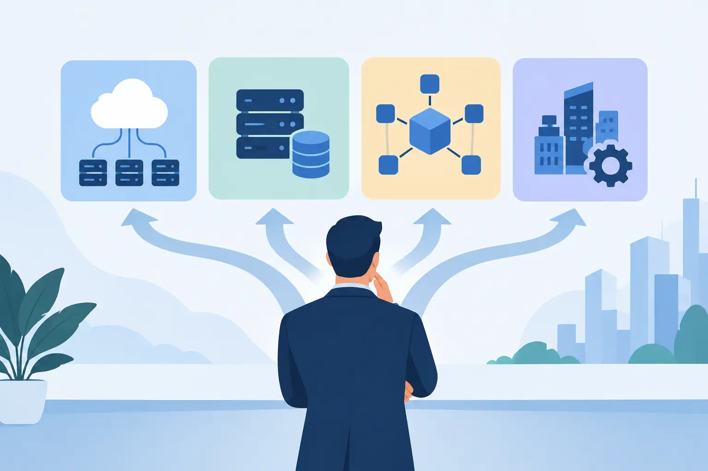

AI programmes rarely fail because an organisation lacks ideas. They fail because decisions about platforms, data, technical debt, controls and operating ownership are made separately. An enterprise architecture decision framework gives leaders a disciplined way to make those choices together, before accelerated delivery converts uncertainty into cost, risk and rework.

For established organisations, this is not an exercise in producing better diagrams. It is a means of directing finite investment towards outcomes that can be measured: faster service, lower operational exposure, stronger compliance, protected institutional knowledge and credible returns from AI. AI does not wait. But urgency is not a reason to fund every modernisation proposal or place sensitive business decisions inside an immature delivery model.

## Why architecture decisions become expensive

Mature technology estates contain years, sometimes decades, of business judgement. Rules embedded in mainframes, spreadsheets, integration layers and the habits of experienced staff may be poorly documented, yet they determine how work is actually done. Replacing or bypassing those systems without understanding that knowledge can create a modern\-looking estate that performs worse.

At the same time, technical debt is often treated as a single backlog to eliminate. That framing encourages broad clean\-up programmes with weak business cases. Some debt constrains AI adoption, resilience, security or regulatory obligations and should be addressed. Some can be contained. Some is the practical cost of supporting a valuable capability that has no immediate replacement case.

The decision is therefore not simply whether a system is old. It is whether its condition, dependencies and knowledge profile limit a priority business outcome. A useful framework makes this question answerable across business, technology, risk and finance teams.

## What an enterprise architecture decision framework must do

A credible enterprise architecture decision framework should turn broad strategic intent into repeatable choices. It establishes a common unit of analysis for initiatives, capabilities, systems and debts, then applies explicit criteria before money and delivery capacity are committed.

The framework should start with a business outcome, not a technology category. “Introduce generative AI” is an ambition. “Reduce the time to resolve customer cases without weakening advice controls” is a decision context. The latter makes it possible to identify the relevant processes, information, systems, controls, skills and measures of return.

It should also force a distinction between decision rights and consultation. Enterprise architecture can clarify options and consequences, but it should not become an approval theatre that obscures who owns the commercial decision, who accepts operational risk and who must maintain the result. The right forum includes accountable business sponsors, architecture, security, data, operations, finance and compliance where the decision warrants it.

Most importantly, the framework needs to make deferral legitimate. A decision to defer is not avoidance when it is based on known constraints, a documented risk position and a review point. Without that discipline, organisations either rush into weak commitments or keep work moving indefinitely without a clear investment choice.

## The five tests for material decisions

For major change, use five connected tests. They are deliberately demanding. A proposal that passes only the technology test is not ready for enterprise funding.

### 1\. Value: what changes, for whom and by when?

Define the measurable result before selecting the solution. This may be revenue protected, cost removed, cycle time reduced, resilience improved, risk avoided or capacity released. Specify the baseline, intended improvement, accountable owner and the time period in which benefits should appear.

For AI use cases, distinguish local productivity claims from enterprise value. A pilot may show that an assistant produces acceptable drafts. That does not prove value if the work still requires full manual review, if it cannot access governed information or if adoption disrupts an established control process. Value is measured by what returns, not by what can be demonstrated.

### 2\. Knowledge: what must not be lost?

Assess the business knowledge carried by the existing estate. Look beyond formal requirements. Identify exception handling, calculation logic, customer commitments, operational workarounds, data meanings and the people who understand why a control exists.

This test changes the modernisation conversation. A legacy application may be expensive to maintain yet contain irreplaceable decision logic. In that case, knowledge preservation and extraction may be the first investment, rather than a replacement programme. Conversely, a lightly used service with unclear ownership may be a better candidate for retirement than a highly visible but business\-critical legacy platform.

### 3\. Constraint: what is genuinely blocking progress?

Map technical debt to the outcome in question. Does the debt prevent reliable data access? Does it create an unacceptable security exposure? Does it make model monitoring impossible, delay releases or leave the organisation dependent on one retiring specialist? If the answer is no, wholesale remediation may not be justified now.

This is where leaders avoid the false choice between “modernise everything” and “do nothing”. The practical alternative is targeted debt reduction: address the constraints that limit a priority capability, contain the remainder and revisit it when the economic case changes.

### 4\. Control: can the organisation operate this safely?

AI\-enabled services need more than model selection. Consider data provenance, access management, human oversight, auditability, supplier exposure, incident response, model performance monitoring and the ability to stop or roll back a harmful outcome. The question is not whether a control exists on paper. It is whether teams can operate it at the pace the service requires.

Control requirements vary. An internal knowledge assistant handling approved procedures has a different risk profile from an AI service influencing credit, clinical, employment or customer outcomes. The framework should scale governance to impact without allowing low\-risk experimentation to become an ungoverned route into production.

### 5\. Capability: who will sustain the change?

Every architecture decision is also an operating\-model decision. Confirm who owns the product, data, controls, model behaviour, supplier relationship and benefits measurement after implementation. Test whether teams have the skills, capacity and decision authority to perform those roles.

A technically viable programme can still fail when responsibility is split across functions that have never worked through the lifecycle together. Training, clear accountabilities and practical working methods are not change\-management extras. They are part of the investment required to make returns durable.

## Make the decision visible

A framework is useful only when it produces a clear record. For each material decision, document the outcome sought, options considered, evidence used, assumptions, dependencies, risks accepted, decision owner, investment threshold and review date. Keep this record concise enough to be read by an executive sponsor, but specific enough that delivery teams understand the boundaries.

The options should be real. For a legacy dependency affecting an AI initiative, alternatives might include preserving and exposing the existing logic, extracting rules into a managed service, rebuilding a bounded component, buying a replacement or postponing the use case. Each option carries different cost, time, knowledge\-loss and control implications. Pretending that replacement is automatically the strategic option is how organisations fund disruption without improving capability.

Architecture review should then focus on decisions that are hard to reverse, costly to unwind or likely to create enterprise\-wide dependencies. Routine delivery choices do not need executive attention. This prevents the architecture practice from becoming a bottleneck while ensuring consequential choices receive proper scrutiny.

## Use investment horizons, not one giant roadmap

Long transformation roadmaps often become commitments to assumptions that no longer hold. A better approach is to organise decisions across horizons.

The near horizon funds immediate constraints on valuable work: critical data quality, a security gap, undocumented legacy rules or an ownership failure that prevents controlled AI deployment. The medium horizon builds reusable capabilities, such as governed knowledge assets, integration patterns, architecture standards and operating routines. The longer horizon addresses strategic platform shifts once evidence supports the direction.

This is not an argument against ambition. It is an argument for sequencing ambition so that early work improves the organisation’s capacity to make the next decision. Each funded increment should reduce uncertainty, produce a usable outcome or retire a material risk.

## The discipline that protects AI returns

The strongest architecture practices do not claim to predict every consequence. They create conditions for better decisions when evidence is incomplete and pressure is high. They expose trade\-offs early, preserve knowledge before it disappears and prevent technical activity from being mistaken for progress.

Resilient ROI applies this discipline through architecture practice development, technical\-debt decision support and AI operating\-model enablement. The aim is not to slow delivery. It is to ensure accelerated delivery does not create liabilities faster than the organisation can govern them.

Start with the next decision that carries meaningful cost or risk. Name the outcome, identify the knowledge at stake, test the constraint, prove the controls and assign operational ownership. That is how architecture becomes a practical instrument for returns, rather than a record of decisions already made.
